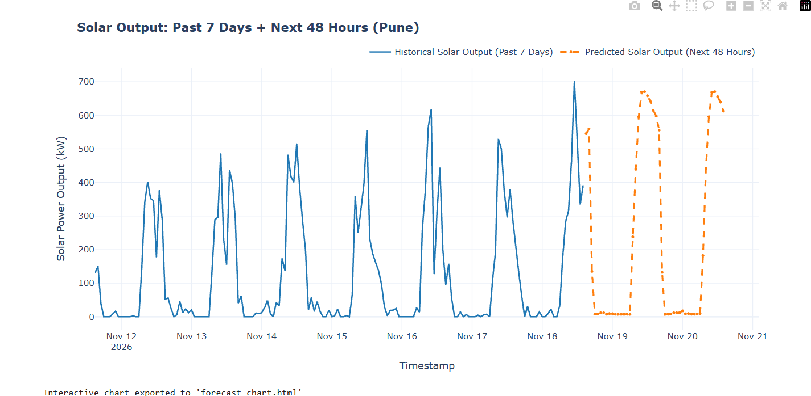

# Solar Power Prediction (Pune, India)

**Candidate / Author:** [YOUR NAME]  
**Location:** Pune, Maharashtra, India (Latitude: 18.52, Longitude: 73.86)  

A machine learning project to predict hourly solar power output (kW) in Pune using weather data and a 48-hour forecast from Open-Meteo.

---

## 1. Project Overview
Solar power depends on daylight and weather conditions like cloud cover, temperature, and humidity. This project:
1. Cleans 60 days of hourly weather data (1 Jan - 29 Feb 2024).
2. Adds time features: hour, sin/cos of hour, day of week, and weekend flag.
3. Splits data chronologically: first 50 days to train, last 10 days to validate (no shuffling).
4. Trains a Linear Regression baseline and tunes a Random Forest model.
5. Fetches a 48-hour Pune weather forecast from Open-Meteo (free, no API key).
6. Predicts future solar output (clipped at 0) and plots history + forecast in Plotly.

---

## 2. Folder Structure
```text
SPP App/
│
├── Solar_Power_Prediction.ipynb   # Main notebook with all steps and outputs
├── preprocess.py                  # Functions to clean data and add features
├── weather_api.py                 # Function to fetch Pune weather forecast
├── train.py                       # Function to train, compare, and save models
├── best_solar_model.pkl           # Saved Random Forest model
├── solar_weather_dataset.csv      # 60 days of hourly weather data
├── forecast_chart.html            # Interactive Plotly chart
├── chart.png                      # Screenshot of the chart
├── requirements.txt               # Python dependencies
├── .gitignore                     # Git ignore file
└── README.md                      # Project documentation
```

---

## 3. Setup and How to Run

1. Open a terminal in this folder:
   ```bash
   cd "SPP App"
   ```
2. Create and activate a virtual environment:
   ```bash
   python -m venv venv
   # Windows:
   venv\Scripts\activate
   # Mac/Linux:
   source venv/bin/activate
   ```
3. Install dependencies:
   ```bash
   pip install -r requirements.txt
   ```
4. Run Jupyter Notebook:
   ```bash
   jupyter notebook Solar_Power_Prediction.ipynb
   ```
   Run all cells from top to bottom.

---

## 4. Weather API
- **Source:** [Open-Meteo](https://open-meteo.com/)
- **Coordinates:** Pune (Lat 18.52, Lon 73.86)
- **Why no key:** Open-Meteo is free and open to everyone without needing an API key or account.
- **Handling errors:** The code asks for wind speed in m/s (`wind_speed_unit=ms`). Requests are retried up to 3 times (with a 2-second pause, including rate-limit 429 responses). If the API cannot be reached, the code uses fallback data so it does not crash.

---

## 5. Model Results (Validation Set)

Evaluated on the last 10 days (240 hours) after training on the first 50 days (1200 hours):

| Model | Hyperparameters | MAE (kW) | RMSE (kW) | R² Score |
| :--- | :--- | :---: | :---: | :---: |
| Linear Regression (Baseline) | Default | 59.14 | 79.81 | 0.7707 |
| Random Forest | n_estimators=50, max_depth=5 | 18.38 | 26.50 | 0.9747 |
| Random Forest | n_estimators=50, max_depth=10 | 15.27 | 20.87 | 0.9843 |
| Random Forest | n_estimators=50, max_depth=None | 15.46 | 20.98 | 0.9842 |
| Random Forest | n_estimators=100, max_depth=5 | 18.38 | 26.67 | 0.9744 |
| Random Forest | n_estimators=100, max_depth=10 | 15.24 | 20.83 | 0.9844 |
| Random Forest | n_estimators=100, max_depth=None | 15.46 | 20.98 | 0.9842 |
| Random Forest | n_estimators=150, max_depth=5 | 18.39 | 26.65 | 0.9744 |
| **Random Forest (Best)** | **n_estimators=150, max_depth=10** | **15.04** | **20.54** | **0.9848** |
| Random Forest | n_estimators=150, max_depth=None | 15.33 | 20.69 | 0.9846 |

Random Forest with 150 trees and max depth 10 gave the lowest RMSE (20.54 kW) and highest R² (0.9848), clearly beating the Linear Regression baseline.

---

## 6. Sample 24-Hour Forecast Table

| Timestamp | Temperature (°C) | Cloud Cover (%) | Humidity (%) | Predicted Solar (kW) |
| :---: | :---: | :---: | :---: | :---: |
| 2026-11-18 15:00:00 | 30.0 | 11 | 29 | 545.46 |
| 2026-11-18 16:00:00 | 29.2 | 0 | 31 | 559.17 |
| 2026-11-18 17:00:00 | 28.1 | 0 | 34 | 135.11 |
| 2026-11-18 18:00:00 | 26.9 | 0 | 37 | 7.95 |
| 2026-11-18 19:00:00 | 26.5 | 3 | 37 | 7.97 |
| 2026-11-18 20:00:00 | 25.0 | 1 | 42 | 11.77 |
| 2026-11-18 21:00:00 | 23.8 | 1 | 45 | 11.89 |
| 2026-11-18 22:00:00 | 22.9 | 0 | 48 | 7.64 |
| 2026-11-18 23:00:00 | 22.1 | 1 | 51 | 9.49 |
| 2026-11-19 00:00:00 | 21.3 | 0 | 55 | 9.00 |
| 2026-11-19 01:00:00 | 21.0 | 1 | 56 | 7.38 |
| 2026-11-19 02:00:00 | 20.5 | 0 | 57 | 7.40 |
| 2026-11-19 03:00:00 | 19.8 | 0 | 60 | 7.47 |
| 2026-11-19 04:00:00 | 19.1 | 0 | 62 | 7.34 |
| 2026-11-19 05:00:00 | 18.4 | 0 | 65 | 7.40 |
| 2026-11-19 06:00:00 | 18.0 | 0 | 66 | 7.21 |
| 2026-11-19 07:00:00 | 18.8 | 0 | 63 | 238.05 |
| 2026-11-19 08:00:00 | 20.8 | 0 | 55 | 439.59 |
| 2026-11-19 09:00:00 | 23.1 | 0 | 46 | 595.31 |
| 2026-11-19 10:00:00 | 25.3 | 0 | 40 | 668.94 |
| 2026-11-19 11:00:00 | 26.9 | 0 | 35 | 670.32 |
| 2026-11-19 12:00:00 | 28.1 | 0 | 32 | 658.23 |
| 2026-11-19 13:00:00 | 28.9 | 0 | 28 | 641.47 |
| 2026-11-19 14:00:00 | 29.2 | 0 | 28 | 614.12 |

---

## 7. Visualization


The interactive version is saved as `forecast_chart.html`. You can open it in any browser to hover over data points and zoom in.

---

## 8. Assumptions
1. **Timezone:** The API is requested with `timezone=Asia/Kolkata` and compared with the computer’s current time, so the code assumes the computer is set to Indian time (IST). The dataset timestamps are treated as local time too.
2. **Missing forecast fields:** If a field is missing from the API response, a default value is used (like 25 °C and 50% humidity). Empty values inside the lists are filled from neighbouring hours with interpolation.
3. **Night solar power:** Solar generation is near 0 at night (the dataset's noise gives about 8 kW on average). Negative predictions are clipped to 0.
4. **History shift for chart:** Historical data (2024) is shifted forward by whole days so it connects directly with the forecast (today), which preserves the hour of the day.
5. **No shuffling:** Data is split chronologically (first 50 days train, last 10 days validation) so future rows do not leak into training.
6. **Valid ranges:** Humidity and cloud cover are clipped to 0–100%, and wind speed, rain, and solar power cannot be negative.
7. **Trigonometric hour:** Using sin and cos of the hour connects 23:00 and 00:00 smoothly, because 11 PM and midnight are only one hour apart.

---

## 9. What I Would Improve Next
1. Collect data for other seasons (monsoon and summer) to see how heavy clouds and heat affect predictions.
2. Try other simple models like XGBoost to compare speed and accuracy.
3. Build a small web UI using Streamlit so anyone can check the forecast easily.
